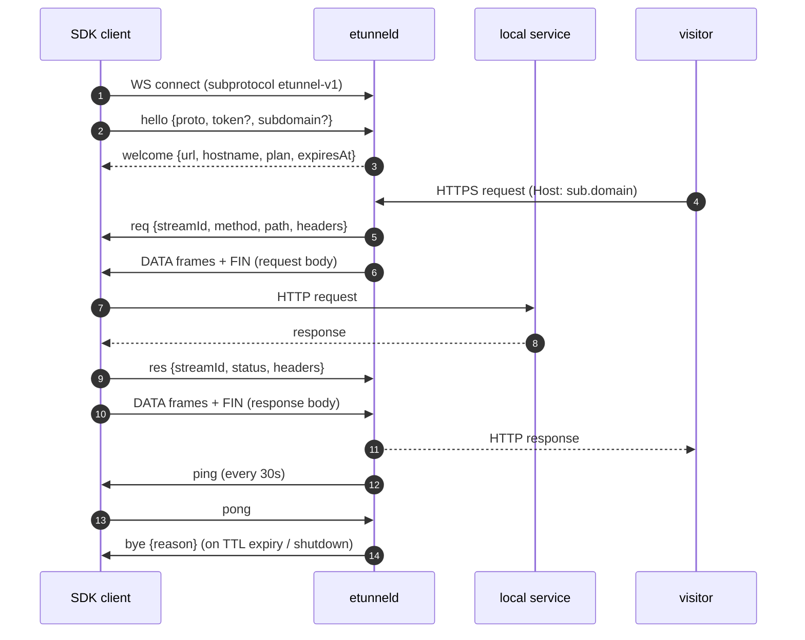
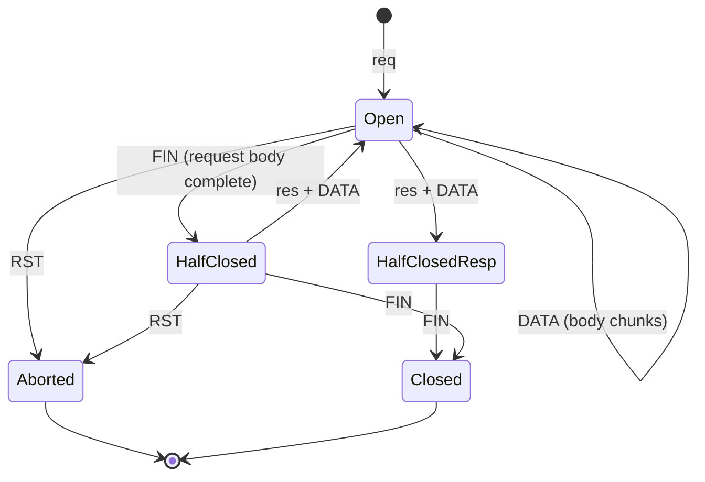

# etunnel wire protocol (v1)

One WebSocket connection per tunnel. Negotiated subprotocol: `etunnel-v1`.
The connection carries two kinds of messages:

- **Text messages** — JSON control messages (`{"type": ...}`)
- **Binary messages** — multiplexed stream frames with a fixed 9-byte header

The server is authoritative for hostnames, plans and lifetimes. Either side
may close at any time; the other side treats that as end-of-tunnel.



## Binary frame layout (big endian)

```
byte     0        frame kind
uint32   1..4     stream ID
uint32   5..8     payload length N
bytes    9..9+N   payload
```

| Kind | Name | Meaning |
|------|------|---------|
| 0x01 | DATA | a chunk of the stream body (request or response side) |
| 0x02 | FIN  | sender finished writing on this stream |
| 0x03 | RST  | abort the stream (peer gone / error) |

Constraints: N ≤ 32768; larger bodies are chunked across DATA frames. Empty
payloads are legal (typical for FIN). Client frames MUST be masked per
RFC 6455; server frames are unmasked. (Robustness: the server also accepts
frames delivered with the *text* opcode — it sniffs the first byte: JSON
control messages start with `{`, frames with a kind byte.)

## Control messages

### 1. Handshake

Client → server:

```json
{"type":"hello","proto":1,"subdomain":"optional","token":"optional","client":"etunnel-x/1.0"}
```

- `proto` must be `1`
- `subdomain` requires a paid plan; free tunnels get a random
  `adjective-noun-nn` name
- `token` is the API key from `/api/register`

Server → client (success):

```json
{"type":"welcome","proto":1,"hostname":"quick-fox-42.t.example.com",
 "subdomain":"quick-fox-42","url":"https://quick-fox-42.t.example.com",
 "expiresAt":1762548000,"plan":"Free"}
```

`expiresAt` is unix seconds (0/absent = no TTL limit).

Server → client (failure):

```json
{"type":"error","code":"subdomain_taken","message":"..."}
```

Error codes: `proto_version`, `unauthorized`, `subdomain_taken`,
`subdomain_plan`, `subdomain_invalid`, `limit_reached`, `too_many_tunnels`,
`bad_message`.

### 2. Request forwarding (server → client)

When a visitor hits `https://<sub>.<domain>/path`, the server opens a stream
(odd stream IDs are server-originated) and sends:

```json
{"type":"req","streamId":1,"method":"POST","path":"/api/echo?x=1",
 "headers":{"Content-Type":["application/json"],"X-Forwarded-For":["203.0.113.9"], ...}}
```

followed by `DATA` frames carrying the request body and a `FIN` when the body
is complete (upgrade requests carry no body and get no FIN — the stream then
stays a bidirectional pipe, see §5).

Hop-by-hop headers (`Connection`, `Transfer-Encoding`, `Keep-Alive`, `Te`,
`Trailer`, `Proxy-*`) are stripped by the server — **except on upgrade
requests** (those carrying `Connection: Upgrade` / an `Upgrade` header),
where `Connection` and `Upgrade` are forwarded verbatim and `Sec-WebSocket-*`
headers pass through, so a 101 response turns the stream into a raw
bidirectional pipe (§5).

`etunneld` is the edge, so it **rewrites** rather than extends the forwarding
headers: any client-supplied `X-Forwarded-For`, `X-Forwarded-Host` or
`X-Real-Ip` is discarded and replaced with the observed peer address
(`X-Forwarded-For`), the public `Host` (`X-Forwarded-Host`) and the same peer
IP (`X-Real-Ip`), alongside `X-Forwarded-Proto`. The canonical Go SDK restores
`X-Forwarded-Host` as the request `Host` the local service sees; other SDKs
should read the header for absolute URLs and same-origin checks.

The client executes the request against the local service and answers:

```json
{"type":"res","streamId":1,"status":200,
 "headers":{"Content-Type":["application/json"]}}
```

followed by `DATA` frames with the response body and `FIN` at the end.

Timeouts: the server waits ~30s for `res` (then answers the visitor with 504);
if the tunnel dies mid-exchange the visitor gets 502. A stream that stops
making progress is reset on its own (`RST`) instead of stalling the whole
tunnel.



### 3. Heartbeat

Either side may send `{"type":"ping","ts":<unix>}`; the peer answers
`{"type":"pong","ts":<same ts>}`. The server pings every 30s and closes the
tunnel (`ping_timeout`) if neither pongs nor traffic are seen for ~150s.

### 4. Teardown

Either side sends `{"type":"bye","reason":"ttl_expired"}` best-effort before
closing the socket. Notable reasons: `ttl_expired`, `ping_timeout`,
`server_shutdown`, `client closed`, `read closed`.

Reasons a server ends a tunnel proactively:

| Reason | Trigger |
|---|---|
| `ttl_expired` | plan lifetime elapsed (4h free / 72h starter / 30d pro) |
| `ping_timeout` | no pong/activity within the liveness window |
| `server_shutdown` | server draining |

### 5. WebSocket pass-through (101 upgrade)

If the local service answers `101 Switching Protocols`, the client reports
`{"type":"res","streamId":N,"status":101,"headers":{...Sec-WebSocket-*...}}`
and the stream becomes a raw bidirectional byte pipe: subsequent `DATA`
frames in both directions are the upgraded-protocol bytes. The server hijacks
the visitor connection and relays raw bytes. `FIN` from either side half
closes, `RST` aborts. (Supported by the Go SDK; buffer-based SDKs skip
upgrade forwarding.)

## Bandwidth & limits

- Free: 1 Mbps token bucket applied to the tunnel's combined proxy traffic
  (both directions); request streams are additionally bounded per tunnel
  (default 256 concurrent).
- Paid: 10 Mbps. Excess traffic waits (smooth shaping), it is not dropped.

## Wire limits

Third-party SDKs must honour these; they are enforced by the reference server
and Go SDK and documented here so every implementation agrees.

| Limit | Value | Notes |
|---|---|---|
| Control message size | 64 KiB | One JSON text message. Larger is rejected with `bad_message` ("control message exceeds 65536 bytes"), never silently truncated. |
| Stream frame payload | 64 KiB minus header | See the binary frame layout above. |
| WebSocket read limit | 128 KiB | Frames larger than this close the connection. |
| `hello` deadline | 15 s | A connection that sends no valid `hello` in time is closed. |
| Concurrent streams per tunnel | 256 (default) | A request over the cap gets HTTP 429 and the client receives `error{code:"too_many_streams"}`. |
| `welcome`/`hello` `proto` | 1 | Receivers must reject a mismatched `proto` instead of parsing the other version's traffic. |

### Unknown control types

A control message whose `type` this implementation does not know must be
**ignored**, not treated as fatal: that is what lets a newer peer introduce new
control messages without disconnecting older servers or SDKs. Malformed
payloads of *known* types remain fatal, because they indicate a broken peer.
The SDKs and the reference server implement this via
`protocol.IsUnknownControlType`.

