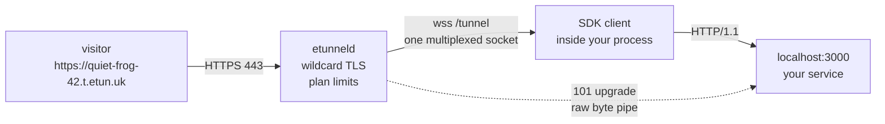
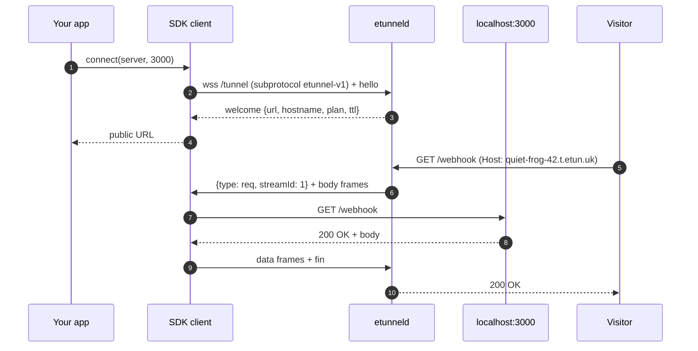

# etunnel


[](https://www.npmjs.com/package/@easytunnel/et-sdk)
[](https://crates.io/crates/etunnel)
[](https://pypi.org/project/etunnel/)
[](https://www.nuget.org/packages/etunnel)
[](https://hex.pm/packages/etunnel)
[](https://luarocks.org/modules/topcheer/ggcode.etunnel)
[](https://pub.dev/packages/etunnel)
[](https://packagist.org/packages/ggcode/etunnel)
[](https://clojars.org/dev.ggcode/etunnel-clj)
[](https://jsr.io/@ggcode/etunnel)
[](https://pkg.go.dev/github.com/topcheer/etunnel)
[](https://central.sonatype.com/artifact/dev.ggcode/etunnel)
[](integration_test.go)

**Your localhost, on the internet.** etunnel gives a service running on your
machine a public HTTPS URL by opening one outbound WebSocket - no inbound port,
no router configuration, no firewall rule, no signup.

- **Instant TLS** - the server holds a wildcard certificate, so every tunnel is
  `https://` from the first request. Webhooks, OAuth callbacks and payment IPNs
  work on the first try.
- **Anonymous by default** - a random subdomain, 4-hour lifetime, 1 Mbps, no
  account. A paid API key adds custom subdomains, longer lifetimes and 10 Mbps.
- **20 SDKs, one protocol** - embed the tunnel in your own process (Go, Node,
  Python, Java, Kotlin, Scala, C#, Rust, Swift, Dart, Ruby, PHP, Perl, Lua,
  Clojure, Elixir, Deno, TypeScript, C, C++).
- **Self-hostable** - the server is a single Go binary with ACME built in.
- **WebSocket pass-through** - the Go SDK relays 101 upgrades as a raw byte
  pipe, so realtime apps work through the tunnel too.

Live deployment: `wss://t.etun.uk/tunnel`, tunnels at
`https://<name>.t.etun.uk`. Point any client at your own server with
`-server` / `ETUNNEL_SERVER` / the first `connect()` argument.

## How it works





Nothing is stored: the server just matches the `Host` header to a live session,
allocates a stream id and relays frames. When the client disconnects (or the
plan TTL expires) the subdomain is released immediately.

## Quickstart

### CLI - one command, any SDK

```sh
npx @easytunnel/et-sdk 3000
#   TUNNEL_URL: https://quiet-frog-42.t.etun.uk
#   plan: Free, expires in 4h
```

Every SDK's file is also a runnable CLI: `etunnel 3000` (Go), `python -m etunnel 3000`,
`dotnet run Etunnel.cs 3000`, `swift run etunnel 3000`, `php etunnel.php 3000`.
Each package README lists its own.

### Embedded - the tunnel lives inside your process

Go:

```go
tunnel, err := etunnel.Connect(ctx, etunnel.Options{
    Server:    "wss://t.etun.uk/tunnel",
    LocalAddr: "127.0.0.1:3000",
    // Token: "et_...", Subdomain: "myapp",   // paid plan
})
if err != nil {
    return err
}
defer tunnel.Close("app exiting")
log.Printf("public URL: %s", tunnel.URL())
```

Node:

```js
const { connect } = require('@easytunnel/et-sdk');
const tunnel = await connect('wss://t.etun.uk/tunnel', 3000);
console.log(tunnel.url);
```

Python:

```python
from etunnel import connect

tunnel = connect("wss://t.etun.uk/tunnel", 3000)
print(tunnel["url"])
```

PHP:

```php
$tunnel = Etunnel::connect('wss://t.etun.uk/tunnel', 3000);
echo $tunnel->url;
```

Every snippet is published on the landing page of the deployment
(<https://t.etun.uk>), one tab per language, always in sync with the SDKs.

### All 20 SDKs

| Language | Install | Embed | Docs |
|---|---|---|---|
| Go | `go get github.com/topcheer/etunnel/sdk` | `Connect(ctx, Options{...})` | [sdk/](sdk/README.md) |
| Node.js | `npm install @easytunnel/et-sdk` | `connect(server, 3000)` | [sdks/node](sdks/node/README.md) |
| TypeScript | `npm install @easytunnel/et-sdk` | `connect(server, 3000)` | [sdks/typescript](sdks/typescript/README.md) |
| Deno | `deno add jsr:@ggcode/etunnel` | `connect(server, 3000)` | [sdks/deno](sdks/deno/README.md) |
| Python | `pip install etunnel` | `connect(server, 3000)` | [sdks/python](sdks/python/README.md) |
| Java | `dev.ggcode:etunnel` | `Etunnel.connect(server, 3000, null)` | [sdks/java](sdks/java/README.md) |
| Kotlin | `dev.ggcode:etunnel` | `Etunnel.connect(server, 3000)` | [sdks/kotlin](sdks/kotlin/README.md) |
| Scala | `dev.ggcode:etunnel` | `Etunnel.connect(server, 3000)` | [sdks/scala](sdks/scala/README.md) |
| C# | single file / `etunnel` NuGet | `await Etunnel.Connect(server, "3000")` | [sdks/csharp](sdks/csharp/README.md) |
| Rust | `cargo install etunnel` | binary - spawn as child | [sdks/rust](sdks/rust/README.md) |
| Swift | single file (Foundation) | `try await Etunnel(...).connect()` | [sdks/swift](sdks/swift/README.md) |
| Dart | `dart pub add etunnel` | `Etunnel.connect(server, '3000')` | [sdks/dart](sdks/dart/README.md) |
| Ruby | `gem install etunnel` | `Etunnel.connect(server, 3000)` | [sdks/ruby](sdks/ruby/README.md) |
| PHP | `composer require ggcode/etunnel` | `Etunnel::connect(...)` | [sdks/php](sdks/php/README.md) |
| Perl | single file (core modules) | `etunnel_connect(...)` | [sdks/perl](sdks/perl/README.md) |
| Lua | `luarocks install ggcode.etunnel` | script | [sdks/lua](sdks/lua/README.md) |
| Clojure | `dev.ggcode/etunnel-clj` | `(et/connect! server 3000)` | [sdks/clojure](sdks/clojure/README.md) |
| Elixir | `{:etunnel, "~> 1.2"}` | `Etunnel.start_link(...)` | [sdks/elixir](sdks/elixir/README.md) |
| C | single file (`make`) | binary - spawn as child | [sdks/c](sdks/c/README.md) |
| C++ | single file (`cmake`) | binary - spawn as child | [sdks/cpp](sdks/cpp/README.md) |

Capability differences (streaming bodies, WebSocket pass-through) are in the
[SDK matrix](sdks/README.md#capability-matrix).

## Plans

| | Free (anonymous) | Starter | Pro |
|---|---|---|---|
| Registration | none | API key | API key |
| Subdomain | random `word-word-42` | 1 custom | 5 custom |
| Tunnel lifetime | 4 hours | 72 hours | 30 days |
| Bandwidth | 1 Mbps | 10 Mbps | 10 Mbps |
| Concurrent tunnels | 2 per account (5 per IP when anonymous) | 5 | 20 |

Tiers are configuration, not code: `etunneld -tiers tiers.json` maps a tier id to
`{name, ttlHours, customDomains, bandwidthMbps, maxTunnels}` (`maxTunnels: 0`
means unlimited).

## Paid plans

Sign in and subscribe from the portal - activation is immediate and mints your
API key:

```sh
open https://t.etun.uk/pricing     # Google / GitLab / GitHub / Apple login
# then /me manages the key, custom subdomains and the subscription

etunnel -server wss://t.etun.uk/tunnel -token et_... -subdomain mydev 3000
```

Signing in claims the account bound to the verified email address. If that
account was created by checkout, claiming it rotates the previous API key: any
tunnel still running on the old key disconnects and must be restarted with the
key shown on `/me`.

## Server (etunneld)

One static binary, four TLS modes:

| `-tls-mode` | Certificates | When |
|---|---|---|
| `http` | none | behind a load balancer that terminates TLS |
| `static` | `-tls-cert` / `-tls-key`, hot-reloaded | you already have a wildcard cert |
| `ondemand` | ACME HTTP-01 per hostname | needs `:80` reachable, small deployments |
| `dns` | ACME DNS-01 wildcard (`-dns-provider cloudflare\|alidns\|dnspod`) | no TLS handshake latency for new subdomains |

```sh
# wildcard certificate via DNS-01 (recommended)
etunneld -domain t.example.com -addr :443 -http-addr :80 \
         -tls-mode dns -dns-provider cloudflare \
         -acme-dir /var/lib/etunnel/acme -acme-email you@example.com

# per-hostname certificates via HTTP-01
etunneld -domain t.example.com -addr :443 -http-addr :80 \
         -tls-mode ondemand -acme-dir /var/lib/etunnel/acme -acme-email you@example.com

# your own certificate (hot-reloaded) or plain HTTP behind an LB
etunneld -domain t.example.com -tls-mode static -tls-cert fullchain.pem -tls-key privkey.pem
```

`-alias-domain t.old.com` serves a legacy domain alongside `-domain` during a
migration (static wildcard cert from the ACME directory, not renewed).

### Endpoints

| Path | Purpose |
|---|---|
| `wss://<domain>/tunnel` | SDK WebSocket endpoint (subprotocol `etunnel-v1`) |
| `POST /api/register` | `{"email"}` -> free-tier API key |
| `GET /api/tiers` | plan catalog |
| `/` | landing page (quickstart, pricing) |
| `/pricing`, `/login`, `/me` | subscription flow and account dashboard |
| `/setlang` | UI language switch (sets the `et_lang` cookie, redirects back) |
| `/webhooks/stripe`, `/webhooks/paypal` | payment provider callbacks |
| `127.0.0.1:9090/stats` | live tunnels, uptime, byte counters, billing status |
| `127.0.0.1:9090/admin/accounts` | account management (`X-Admin-Token`) |

The web UI (landing, pricing, billing, login, `/me`) is localized in 11
languages — English, 简体中文, 日本語, 한국어, Deutsch, Français, Español,
Português, Italiano, Русский and العربية (RTL). Language is negotiated from
the `et_lang` cookie, then `Accept-Language`, then English; the footer
switcher calls `/setlang`.

### Operational limits

- Per-IP concurrent anonymous tunnels (`-max-tunnels-per-ip`) and a per-account
  cap that scales with the tier (`Tier.MaxTunnels`, rejection code
  `limit_reached`), per-tunnel stream cap (`-max-streams`), plan TTL and
  bandwidth (token bucket, both directions).
- Heartbeats both ways (`ping`/`pong` plus WS ping), stalled streams are reset
  instead of freezing the tunnel.
- Accounts persist to a JSON file with atomic writes.

## Multi-instance (cluster)

One binary, three modes - `ETUNNEL_CLUSTER=single` (default, today's node),
`mesh` (gossip + cross-peer forwarding, behind any L4 LB) and `sticky`
(Redis routing table for L7 LBs). Shared services are env-driven:
`ETUNNEL_PG_DSN` (accounts), `ETUNNEL_REDIS_URL` (exact global limits),
`SESSION_SECRET` (signs cookies + resume tokens - required multi-instance).
`/healthz` on the main port reports 200/drain; SIGTERM drains before
sessions close, and SDKs re-land on any peer with the same URL.

Full guide: [deploy/CLUSTER.md](deploy/CLUSTER.md) - modes, verified
deployments (Docker Compose / k3s Helm / bare-metal systemd), scaling.

## Operations: sessions and reconnect

The server signs two things with `SESSION_SECRET`: OAuth session cookies and
the `resumeToken` that lets a reconnecting client reclaim its subdomain.

```sh
SESSION_SECRET=$(openssl rand -hex 32)   # set once, keep it stable
```

- **Set it in production.** Without it both keys are generated per process:
  a restart logs every user out *and* makes resume tokens unverifiable, so
  reconnecting clients come back on a fresh random subdomain.
- **Rotating it** invalidates existing sessions (users log in again) and any
  outstanding resume tokens (in-flight reconnects get new subdomains).

Clients reconnect automatically and replay their resume token, so the server
hands back the same subdomain (skipping plan gating — the signed token is the
grant). Wire format: [PROTOCOL.md](PROTOCOL.md) · [CHANGELOG](CHANGELOG.md) §1.

## Billing (optional, self-hosted)

Payments are enabled purely by environment variables - empty means off:

```sh
STRIPE_SECRET_KEY=sk_live_<key>          # https://dashboard.stripe.com/apikeys
STRIPE_WEBHOOK_SECRET=whsec_<secret>     # endpoint: https://<domain>/webhooks/stripe
PAYPAL_CLIENT_ID=<client id>             # https://developer.paypal.com
PAYPAL_SECRET=<client secret>
PAYPAL_ENV=sandbox                       # or live
PAYPAL_WEBHOOK_ID=<webhook id>           # endpoint: https://<domain>/webhooks/paypal
TIER_STARTER_PRICE_CENTS=300             # optional overrides (default $3 / $9)
TIER_PRO_PRICE_CENTS=900
```

First payment mints the account and API key for the payer's email;
renewals and upgrades keep the same key and change the tier. Stripe signatures
are verified with HMAC-SHA256 (5 minute tolerance), PayPal through the
`verify-webhook-signature` API.

## Telegram admin bot (optional)

```sh
TELEGRAM_BOT_TOKEN=123456:ABC...   # from @BotFather
TELEGRAM_ADMIN_CHAT_ID=123456789   # your chat id
```

`/status`, `/tunnels`, `/accounts`, `/kick <subdomain>`,
`/tier <email> <tier>`, `/whois <subdomain>`. Only the whitelisted chat is
answered; payments push a notification to it. Long polling - no public webhook.

## Repository layout

```
protocol/     wire protocol: frames + JSON control messages, shared by server and Go SDK
server/       etunneld: sessions, registry, proxy, tiers, TLS/ACME, admin API, billing, portal
sdk/          Go SDK - reference client (streaming + WebSocket pass-through)
cmd/etunneld  server CLI
cmd/etunnel   client CLI
sdks/         20 language clients, one README each (see sdks/README.md)
examples/     runnable examples (see examples/README.md)
scripts/      release, packaging and doc generation helpers
```

## Development

```sh
make verify            # gofmt check, go vet, go test -race ./...
go test ./...          # unit + integration tests
```

The integration tests start a real `etunneld` in-process and drive it with the
Go SDK, the CLI and raw HTTP/WebSocket clients - including TLS, tiers, TTL
expiry, bandwidth limiting and upgrade pass-through.

Docs:

| Document | Contents |
|---|---|
| [PROTOCOL.md](PROTOCOL.md) | frames, control messages, stream lifecycle, limits |
| [sdks/README.md](sdks/README.md) | install matrix, capability comparison, protocol summary |
| [examples/README.md](examples/README.md) | runnable examples per language |
| [PACKAGING.md](PACKAGING.md) | how releases are cut and published to 20 registries |
| [CREDENTIALS.md](CREDENTIALS.md) | every environment variable and OAuth app |

## License

MIT - see [LICENSE](LICENSE).
