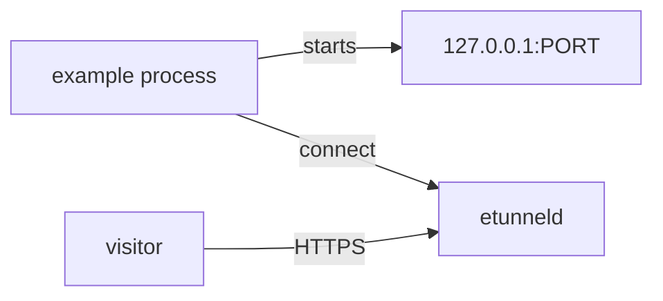

# Examples

Runnable, copy-pasteable examples. Every one starts a local HTTP service, opens
a tunnel to it and prints the public URL.



## Go - embedded tunnel (reference example)

[`basic/main.go`](basic/main.go) starts an `http.Server` on `127.0.0.1:18080`,
exposes it with one `etunnel.Connect` call, prints the public URL and serves
until `Ctrl-C` or until the server drops the tunnel (it then logs the close
reason and exits).

```sh
go run ./examples/basic -server wss://t.etun.uk/tunnel
#   2026/11/25 00:14:28 local service:  http://127.0.0.1:18080/
#   2026/11/25 00:14:28 public URL:     http://rapid-cinder-y3cf57.localhost
#   2026/11/25 00:14:28 plan:           Free (expires 2026-11-25T04:14:28+08:00)
#
#   in another terminal:
#   curl https://<subdomain>.t.etun.uk/
#   hello through the tunnel - client 127.0.0.1:<port>, path /
```

(The log lines above are the program's real output, captured against a local
`-domain localhost` server; on the public server the URL is
`https://<name>.t.etun.uk`.)

Flags: `-server` (default `ETUNNEL_SERVER`, else the SDK's `DefaultServer`),
`-local` (default `127.0.0.1:18080`), `-token` (`ETUNNEL_TOKEN`),
`-subdomain` (`ETUNNEL_SUBDOMAIN`).

## Go - multi-target routing

[`basic/multi/main.go`](basic/multi/main.go) opens **one** tunnel that routes
`/api` to one local service and everything else to another - see
[basic/multi/README.md](basic/multi/README.md).

```sh
go run ./examples/basic/multi -server wss://t.etun.uk/tunnel
```

## One example per language

Each SDK keeps a minimal example next to its source:

| Language | Example | Run |
|---|---|---|
| Node.js | [basic.js](../sdks/node/example/basic.js) | `node sdks/node/example/basic.js` |
| TypeScript | [basic.ts](../sdks/typescript/example/basic.ts) | `node sdks/typescript/example/basic.ts` |
| Deno | [basic.ts](../sdks/deno/example/basic.ts) | `deno run --allow-net sdks/deno/example/basic.ts` |
| Python | [basic.py](../sdks/python/example/basic.py) | `python sdks/python/example/basic.py` |
| Java | [Basic.java](../sdks/java/example/Basic.java) | `java sdks/java/example/Basic.java` |
| Kotlin | [basic.kt](../sdks/kotlin/example/basic.kt) | `kotlinc -script sdks/kotlin/example/basic.kt` |
| Scala | [Basic.scala](../sdks/scala/example/Basic.scala) | `scala sdks/scala/example/Basic.scala` |
| C# | [Basic.cs](../sdks/csharp/example/Basic.cs) | `dotnet run sdks/csharp/example/Basic.cs` |
| Swift | [basic.swift](../sdks/swift/example/basic.swift) | `cd sdks/swift && cat etunnel.swift example/basic.swift > /tmp/b.swift && swift /tmp/b.swift` |
| Dart | [basic.dart](../sdks/dart/example/basic.dart) | `dart run sdks/dart/example/basic.dart` |
| Ruby | [basic.rb](../sdks/ruby/example/basic.rb) | `ruby sdks/ruby/example/basic.rb` |
| PHP | [basic.php](../sdks/php/example/basic.php) | `php sdks/php/example/basic.php` |
| Perl | [basic.pl](../sdks/perl/example/basic.pl) | `perl sdks/perl/example/basic.pl` |
| Lua | [basic.lua](../sdks/lua/example/basic.lua) | `lua sdks/lua/example/basic.lua` |
| Clojure | [basic.clj](../sdks/clojure/example/basic.clj) | `clojure -M sdks/clojure/example/basic.clj` |
| Elixir | [basic.exs](../sdks/elixir/example/basic.exs) | `mix run sdks/elixir/example/basic.exs` |
| C | [basic.sh](../sdks/c/example/basic.sh) | `sh sdks/c/example/basic.sh` (builds with `make`, needs libwebsockets/libcurl/json-c; see the [C README](../sdks/c/README.md)) |
| C++ | [basic.sh](../sdks/cpp/example/basic.sh) | `sh sdks/cpp/example/basic.sh` (CMake build, wss-only; pass `CMAKE_ARGS` on macOS, see the [C++ README](../sdks/cpp/README.md#install)) |

By the cross-SDK contract (AGENTS.md) every SDK example honours
`ETUNNEL_SERVER` and prints `TUNNEL_URL: <url>` on connect; the C and C++
scripts additionally take the local port as their first argument (default
`3000`). Only the Go examples and the two C/C++ scripts were run while this
page was verified.

## Test against your own server

Every example accepts the server URL through `ETUNNEL_SERVER` or `-server`, so
you can point them at a local deployment instead of the public one. Two things
bite people here:

- `etunneld` serves its own endpoints (including the `/tunnel` WebSocket) only
  for the **base domain** `Host` - so dial `ws://<the -domain value>:<port>/tunnel`,
  not `ws://127.0.0.1:<port>/tunnel` (that answers 404). `-domain localhost`
  is the convenient choice for a throwaway server.
- With `-tls-mode http` both listeners (`-addr` and `-http-addr`) accept the
  WebSocket handshake and proxy requests, so one listener is enough.

```sh
# terminal 1 - a throwaway server on plain HTTP, no ACME involved
etunneld -domain localhost -addr 127.0.0.1:18080 -http-addr 127.0.0.1:18081 \
         -tls-mode http -admin-addr 127.0.0.1:19090

# terminal 2 - any example, against that server
ETUNNEL_SERVER=ws://localhost:18081/tunnel go run ./examples/basic
#   public URL:     http://<subdomain>.localhost     <- plain http, port 80 implied

# terminal 3 - the public URL implies port 80, which the throwaway server does
# not own; send the hostname in a Host header instead
curl -H 'Host: <subdomain>.localhost' http://127.0.0.1:18081/
#   hello through the tunnel - client 127.0.0.1:<port>, path /
```

(Verified with the same command on other ports, `28080` / `28280` / `29080`,
because the defaults were taken on the machine that ran it.)

## Common pitfalls

| Symptom | Fix |
|---|---|
| Example prints the URL but `curl` returns 404 | The subdomain changed - the printed URL is the only truth |
| `connection refused` on the local service | Start the local server before `connect()` |
| `dial ... 404` right after starting your own `etunneld` | The server URL host must equal `-domain` (`ws://localhost:PORT/tunnel`), see above |
| Corporate proxy blocks `wss://` | `HTTPS_PROXY=http://proxy:8080` (JVM: `-Dhttps.proxyHost`) |
| Tunnel disappears after a while | Plan TTL (4h free) - restart the client or use a paid plan |

See [PROTOCOL.md](../PROTOCOL.md) for what happens on the wire and
[sdks/README.md](../sdks/README.md) for per-language API details.
