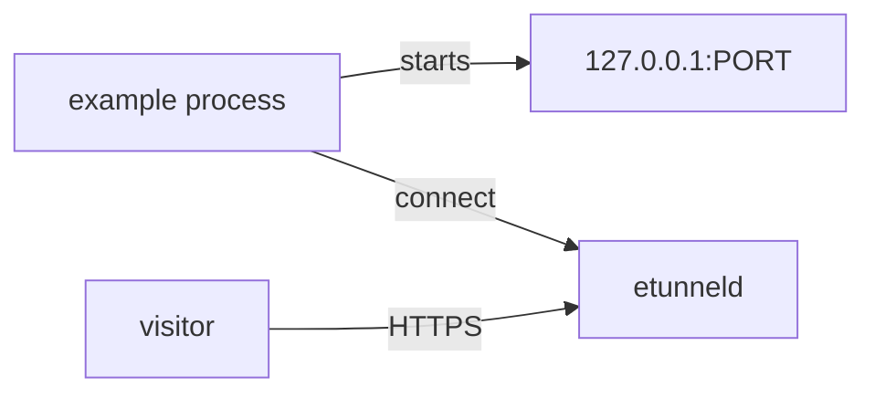

# Examples

Runnable, copy-pasteable examples. Every one starts a local HTTP service, opens
a tunnel to it and prints the public URL.



## Go - embedded tunnel (reference example)

[`basic/main.go`](basic/main.go) starts an `http.Server` on `127.0.0.1:18080`,
exposes it with one `etunnel.Connect` call, prints the public URL and shuts down
cleanly.

```sh
cd examples/basic
go run . -server wss://t.etun.uk/tunnel
#   public URL: https://quiet-frog-42.t.etun.uk
#   plan: Free
#
#   in another terminal:
#   curl https://quiet-frog-42.t.etun.uk/
```

## One example per language

Each SDK keeps a minimal example next to its source:

| Language | Example | Run |
|---|---|---|
| Node.js | [basic.js](../sdks/node/example/basic.js) | `node sdks/node/example/basic.js` |
| TypeScript | [basic.ts](../sdks/typescript/example/basic.ts) | `node sdks/typescript/example/basic.ts` |
| Deno | [basic.ts](../sdks/deno/example/basic.ts) | `deno run --allow-net sdks/deno/example/basic.ts` |
| Python | [basic.py](../sdks/python/example/basic.py) | `python sdks/python/example/basic.py` |
| Java | [Basic.java](../sdks/java/example/Basic.java) | `java sdks/java/example/Basic.java` |
| Kotlin | [basic.kt](../sdks/kotlin/example/basic.kt) | `kotlinc -script sdks/kotlin/example/basic.kt` |
| Scala | [Basic.scala](../sdks/scala/example/Basic.scala) | `scala sdks/scala/example/Basic.scala` |
| C# | [Basic.cs](../sdks/csharp/example/Basic.cs) | `dotnet run sdks/csharp/example/Basic.cs` |
| Swift | [basic.swift](../sdks/swift/example/basic.swift) | `cd sdks/swift && cat etunnel.swift example/basic.swift > /tmp/b.swift && swift /tmp/b.swift` |
| Dart | [basic.dart](../sdks/dart/example/basic.dart) | `dart run sdks/dart/example/basic.dart` |
| Ruby | [basic.rb](../sdks/ruby/example/basic.rb) | `ruby sdks/ruby/example/basic.rb` |
| PHP | [basic.php](../sdks/php/example/basic.php) | `php sdks/php/example/basic.php` |
| Perl | [basic.pl](../sdks/perl/example/basic.pl) | `perl sdks/perl/example/basic.pl` |
| Lua | [basic.lua](../sdks/lua/example/basic.lua) | `lua sdks/lua/example/basic.lua` |
| Clojure | [basic.clj](../sdks/clojure/example/basic.clj) | `clojure -M sdks/clojure/example/basic.clj` |
| Elixir | [basic.exs](../sdks/elixir/example/basic.exs) | `mix run sdks/elixir/example/basic.exs` |
| C | [basic.sh](../sdks/c/example/basic.sh) | `sh sdks/c/example/basic.sh` |
| C++ | [basic.sh](../sdks/cpp/example/basic.sh) | `sh sdks/cpp/example/basic.sh` |

## Test against your own server

Every example accepts the server URL through `ETUNNEL_SERVER`, so you can point
them at a local deployment instead of the public one:

```sh
# terminal 1 - a throwaway server on plain HTTP, no ACME involved
etunneld -domain local.test -addr 127.0.0.1:18080 -http-addr 127.0.0.1:18081 \
         -tls-mode http -admin-addr 127.0.0.1:19090

# terminal 2 - any example, against that server
ETUNNEL_SERVER=ws://127.0.0.1:18080/tunnel go run ./examples/basic
# then: curl -H 'Host: <subdomain>.local.test' http://127.0.0.1:18080/
```

## Common pitfalls

| Symptom | Fix |
|---|---|
| Example prints the URL but `curl` returns 404 | The subdomain changed - the printed URL is the only truth |
| `connection refused` on the local service | Start the local server before `connect()` |
| Corporate proxy blocks `wss://` | `HTTPS_PROXY=http://proxy:8080` (JVM: `-Dhttps.proxyHost`) |
| Tunnel disappears after a while | Plan TTL (4h free) - restart the client or use a paid plan |

See [PROTOCOL.md](../PROTOCOL.md) for what happens on the wire and
[sdks/README.md](../sdks/README.md) for per-language API details.
