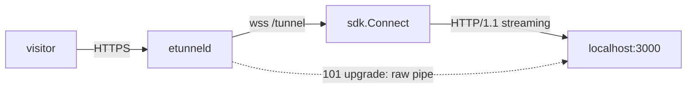

# etunnel SDK for Go (reference client)

[](https://pkg.go.dev/github.com/topcheer/etunnel/sdk)
[](https://pkg.go.dev/github.com/topcheer/etunnel)

The canonical client, and the only one that is not buffer-based:

- **Streaming bodies** - responses are relayed chunk by chunk, flushes are
  preserved, `Transfer-Encoding: chunked` and server-sent events work.
- **WebSocket pass-through** - a `101 Switching Protocols` response hijacks both
  sides into a raw byte pipe, so a realtime service behind a tunnel behaves
  exactly as it does locally.
- **One dependency** - `github.com/coder/websocket` (the transport); everything
  else is the standard library.

The other 19 languages in [`../sdks/`](../sdks/README.md) are buffer-based ports
of the same wire protocol; they cover webhooks, dashboards and APIs.

## Install

```sh
go get github.com/topcheer/etunnel/sdk@latest
```

Module `github.com/topcheer/etunnel`, import path `github.com/topcheer/etunnel/sdk`,
package name `etunnel`.

## AI agent quick-start (copy this prompt)

```text
Integrate etunnel (Go SDK) into this project to expose the local service on port <PORT> at a public HTTPS URL.

- Package: github.com/topcheer/etunnel/sdk (package name `etunnel`, module github.com/topcheer/etunnel) · Install: go get github.com/topcheer/etunnel/sdk@latest
- Server: wss://t.etun.uk/tunnel (override with ETUNNEL_SERVER). Anonymous tier = random subdomain, 4h TTL; a static subdomain needs an API token (Options.Token; a free key holds one static subdomain, paid plans hold more and run longer).
- Minimal embed (verified against the SDK source):
	tunnel, err := etunnel.Connect(context.Background(), etunnel.Options{
		Server:    os.Getenv("ETUNNEL_SERVER"), // "" = DefaultServer (wss://t.etun.uk/tunnel)
		LocalAddr: "127.0.0.1:<PORT>",
	})
	if err != nil { panic(err) } // *etunnel.APIError = policy rejection (Code, Message)
	defer tunnel.Close("app exiting") // frees the subdomain
	fmt.Println("TUNNEL_URL:", tunnel.URL())
	select {} // keep the process alive
- Rules: print the public URL as `TUNNEL_URL: <url>` and keep the process alive; call tunnel.Close(reason) on shutdown to release the subdomain. Unlike the 19 buffer-based SDKs, the Go SDK streams bodies (chunked, SSE, flushes preserved) and passes WebSocket upgrades (101) through as a raw pipe - use it for realtime services as well as webhooks/APIs/dashboards.
- Do not invent other options. Full API/options: https://github.com/topcheer/etunnel/blob/main/sdk/README.md#options. Wire protocol: https://github.com/topcheer/etunnel/blob/main/PROTOCOL.md
```

## Embed in your app

```go
package main

import (
	"context"
	"fmt"
	"os"
	"os/signal"
	"syscall"

	"github.com/topcheer/etunnel/sdk"
)

func main() {
	tunnel, err := etunnel.Connect(context.Background(), etunnel.Options{
		Server:    os.Getenv("ETUNNEL_SERVER"), // "" = DefaultServer (wss://t.etun.uk/tunnel)
		LocalAddr: "127.0.0.1:3000",
	})
	if err != nil {
		panic(err) // *etunnel.APIError, ErrConnect, ErrWelcomeTimeout, ... - see Errors
	}
	defer tunnel.Close("app exiting") // releases the subdomain

	fmt.Println("TUNNEL_URL:", tunnel.URL())

	// Start your own server here. Block until Ctrl-C, or until the server
	// drops the tunnel (TTL expiry, kick) - Done() closes in both cases.
	sig := make(chan os.Signal, 1)
	signal.Notify(sig, os.Interrupt, syscall.SIGTERM)
	select {
	case <-sig:
	case <-tunnel.Done():
	}
}
```



## CLI

```sh
go install github.com/topcheer/etunnel/cmd/etunnel@latest
etunnel -server wss://t.etun.uk/tunnel 3000
# or, straight from a checkout of this repository:
go run ./cmd/etunnel 3000          # needs ETUNNEL_SERVER or -server
```

`-server` (or `ETUNNEL_SERVER`) is required; a bare port means `127.0.0.1:<port>`.
The CLI prints the public URL and keeps the tunnel open until `Ctrl-C`
(real output; here against a local `-domain localhost` server, with
`ETUNNEL_RECONNECT=0` - the default reconnecting mode prints the URL line
only):

```text
  http://flying-beacon-qgwkwp.localhost  ->  http://127.0.0.1:3000
  plan: Free, expires 2026-11-25T03:34:52+08:00
```

| Flag | Meaning |
|---|---|
| `-local ADDR` | local address to expose (default `127.0.0.1:<port arg>`) |
| `-token KEY` | API key (`ETUNNEL_TOKEN`; a free key gets 1 static subdomain) |
| `-subdomain NAME` | request a static subdomain (`ETUNNEL_SUBDOMAIN`; paid plans allow more) |
| `-reconnect` | auto-reconnect with the same URL (default **true**; `ETUNNEL_RECONNECT=0` disables) |
| `-route PREFIX=ADDR[,strip]` | multi-target route, repeatable; replaces `-local` (see [Routes](#routes-multi-target)) |

Note: the Go CLI prints the bare URL on the first stdout line - it does not
prefix it with `TUNNEL_URL:` the way the other SDK CLIs do.

## API

| Symbol | Returns / effect |
|---|---|
| `Connect(ctx, Options)` | `(*Tunnel, error)` - returns after the server's `welcome` |
| `ConnectReconnecting(ctx, Options)` | `(*ReconnectingTunnel, error)` - first dial fails fast, then supervises forever |
| `ReconnectingTunnel.URL()` / `Subdomain()` / `Attempts()` | last-known facts across reconnects |
| `ReconnectingTunnel.Tunnel()` | current `*Tunnel` (nil while a reconnect is in flight) |
| `ReconnectingTunnel.Done()` | closed when the supervisor stops (user close, parent ctx, permanent error) |
| `ReconnectingTunnel.Close(reason)` | stops the supervisor; no reconnect follows |
| `Tunnel.URL()` | `string` - public HTTPS URL |
| `Tunnel.Hostname()` / `Subdomain()` / `Plan()` | connection facts |
| `Tunnel.ExpiresAt()` | `time.Time` - plan TTL deadline |
| `Tunnel.ResumeToken()` | server-signed token that lets a later `Connect` reclaim the subdomain (private `Options.resume`; only `ConnectReconnecting` sets it) |
| `Tunnel.Done()` | `<-chan struct{}` closed when the tunnel ends |
| `Tunnel.CloseReason()` | why the tunnel ended (the server's reason, `"client closed"`, `"context canceled"`, ...) |
| `Tunnel.Err()` | terminal error that ended the tunnel (`*websocket.CloseError` for close frames); nil while running or after `Close` |
| `Tunnel.Close(reason)` | graceful shutdown; the subdomain is freed immediately |
| `ValidateRoutes([]Route)` | `error` - validates a route table with the same rules `Connect` applies |
| `Login(ctx, server, openBrowser)` | `(*Credentials, error)` - browser authorization (see below) |

### Login (browser authorization)

`Login` runs the CLI loopback flow so a desktop app can get an API token
without copy-pasting keys: it binds a random `127.0.0.1` port, asks the
server for an authorization URL, opens the user's browser there (the
`openBrowser` callback; nil uses `open`/`xdg-open` and prints the URL when
headless), waits for the browser to land back on the loopback port with a
one-time code, and exchanges it:

```go
creds, err := etunnel.Login(ctx, "https://t.etun.uk", nil)
if err != nil { ... }
// creds.APIToken, creds.Subdomains, creds.Plan - persist these and pass
// Options{Token: creds.APIToken, ...} on every future Connect.
```

`Credentials` is `{APIToken, Subdomains []string, Plan string, ExpiresAt int64}`;
free accounts get the token with an empty `Subdomains` list. The whole flow
times out after `LoginTimeout` (10 minutes).

### Options

| Field | Meaning |
|---|---|
| `Server` | tunnel endpoint; a bare host gets `wss://` and `/tunnel`, `http(s)://` becomes `ws(s)://`; empty = `DefaultServer` |
| `LocalAddr` | local service address, `"127.0.0.1:3000"` (`":3000"` also works). Required unless `Routes` is set; ignored when it is |
| `Routes` | `[]Route` - multi-target routing by URL path prefix (see below) |
| `Subdomain` | static subdomain; needs `Token` whose account lists that name (free key: 1, paid: more) |
| `Token` | API key (free keys unlock one static subdomain) |
| `Client` | free-form client identifier sent in `hello` |
| `Policy` | `*TunnelPolicy` - edge protection enforced by the server (see below); nil = none |
| `OnLog` | `func(format string, args ...any)` lifecycle log sink |
| `OnReconnect` | `func(attempt int, url string)` - called after each successful reconnect |
| `ReconnectMinBackoff` / `ReconnectMaxBackoff` | backoff bounds for `ConnectReconnecting` (defaults 500ms / 30s, doubling, +-10% jitter, reset after a successful reconnect) |

### Routes (multi-target)

One public hostname, several local services - for example a built SPA on
`/` and its backend on `/api` - without CORS or a second tunnel. Routing is
client-side; the wire protocol is unchanged.

```go
tunnel, err := etunnel.Connect(ctx, etunnel.Options{
	Server: "wss://t.etun.uk/tunnel",
	Routes: []etunnel.Route{
		{PathPrefix: "/api", Addr: "127.0.0.1:8080", StripPrefix: true},
		{PathPrefix: "/", Addr: "127.0.0.1:3000"},
	},
})
```

`Route` is `{PathPrefix, Addr, StripPrefix}`:

- Longest prefix wins; matching is on segment boundaries (`/api` matches
  `/api` and `/api/...`, never `/apiv2`).
- `StripPrefix` removes only the path part - the query string is carried over
  byte-for-byte, an exact hit (`/api`) becomes `/`.
- A request that matches no route (only possible without a `/` fallback) is
  answered `404` by the SDK.
- `Connect` rejects a bad table up front (`etunnel: route[i]: ...`: empty
  `Addr`, prefix not starting with `/`, duplicate prefix, missing `PathPrefix`);
  `ValidateRoutes` runs the same check without connecting.

Runnable demo: [`examples/basic/multi`](../examples/basic/multi/README.md).

### Edge policy (`Policy`)

`Options.Policy` is serialised into `hello.policy` and enforced by the server
before any visitor request reaches your service:

```go
Policy: &etunnel.TunnelPolicy{
	BasicAuth: "user:pass",                                       // HTTP Basic
	AllowIPs:  []string{"10.0.0.0/8", "203.0.113.7"},             // CIDRs / plain IPs
	Webhooks:  []etunnel.WebhookRule{{Provider: "stripe", Secret: "whsec_..."}},
}
```

`WebhookRule.Provider` is one of `stripe`, `github`, `gitlab`; verified
requests reach the local service with `X-Etunnel-Webhook`. Every field is
optional - a nil or all-empty `Policy` sends nothing and behaves as before.

### Reconnecting

`ConnectReconnecting` dials once (so bad credentials fail fast with the real
error) and then rebuilds the tunnel whenever it drops, replaying the server's
signed `resumeToken` so the same subdomain is reclaimed instead of
re-randomised (token lifetime is 30 minutes server-side; after that the
server assigns a fresh subdomain). Retrying stops permanently on errors that
cannot fix themselves (`unauthorized`, `subdomain_plan`, `subdomain_invalid`,
`bad_message`) and on `ErrUnsupportedProto`.

`DefaultServer` is the connect target when `Options.Server` is empty. Override
it at build time for an internal deployment (applies to your own program; the
CLI above always needs `-server`):

```sh
go build -ldflags "-X github.com/topcheer/etunnel/sdk.DefaultServer=wss://tunnel.internal/tunnel" ./cmd/myapp
```

### Errors

Handshake and connect failures are returned by `Connect` / `ConnectReconnecting`:

| Value | When | `errors.As` / `errors.Is` |
|---|---|---|
| `*APIError` | the server rejected `hello`: `Code` is one of `unauthorized`, `subdomain_taken`, `subdomain_plan`, `subdomain_invalid`, `limit_reached`, `too_many_tunnels`, `bad_message`, `proto_version`; `Message` is the human text | `errors.As(err, &apiErr)` |
| `ErrConnect` | the WebSocket dial itself failed (DNS, TLS, refused) - the net error stays wrapped | `errors.Is` |
| `ErrWelcomeTimeout` | socket opened, no `welcome` within 15s | `errors.Is` |
| `ErrParseWelcome` | the `welcome` frame did not decode | `errors.Is` |
| `ErrUnsupportedProto` | the server speaks a strictly newer protocol (permanent) | `errors.Is` |

Local validation errors (`LocalAddr is required`, route table errors) are
plain `error` values prefixed `etunnel: `.

## Behaviour details

- **Header hygiene** - hop-by-hop headers (`Connection`, `Keep-Alive`,
  `Transfer-Encoding`, `Proxy-*`, `TE`, `Trailer`) are stripped in both
  directions; `Upgrade` is consumed by the pass-through path above.
  `etunneld` is the edge: it sets `X-Forwarded-For` and `X-Forwarded-Proto`
  itself and discards any client-supplied value.
- **Streams** - one WebSocket carries many concurrent streams (up to 256),
  each with a 32-bit id. The server sends `req` metadata, then binary data
  frames (32 KiB each), then `fin`; a client can answer with `rst` to abort.
- **Liveness** - application-level `ping`/`pong` plus WebSocket pings. A stalled
  stream is reset individually instead of freezing the tunnel.
- **Grace** - `Close(reason)` sends `bye`, waits for the writer to drain and
  closes the socket. Dropping the process has the same effect server-side.

## Environment variables

| Variable | Meaning | Default |
|---|---|---|
| `ETUNNEL_SERVER` | tunnel server WebSocket URL (CLI; `-server`) | `wss://t.etun.uk/tunnel` |
| `ETUNNEL_LOCAL` | local port or `host:port` (CLI; `-local`) | `3000` |
| `ETUNNEL_TOKEN` | API key (CLI; `-token`) | - |
| `ETUNNEL_SUBDOMAIN` | requested static subdomain (CLI; `-subdomain`) | random |
| `ETUNNEL_RECONNECT` | `0` disables auto-reconnect (CLI; `-reconnect`) | reconnect |

The `Connect` API itself takes everything through `Options`; the environment
variables are read by `cmd/etunnel` (the snippet above reads `ETUNNEL_SERVER`
explicitly).

## Tests

Race-detector-enabled end-to-end tests live at the repository root - they start
an in-process `etunneld` and drive it with this SDK, the CLI and raw
HTTP/WebSocket clients:

```sh
go test -race ./...
```

## See also

- [Wire protocol](../PROTOCOL.md)
- [All 20 SDKs](../sdks/README.md)
- [Runnable example](../examples/basic/main.go) and [multi-target example](../examples/basic/multi/README.md)
- [LICENSE](../LICENSE) - MIT
