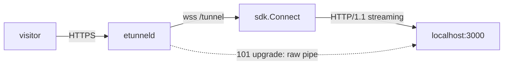

# etunnel SDK for Go (reference client)

[](https://pkg.go.dev/github.com/topcheer/etunnel/sdk)
[](https://pkg.go.dev/github.com/topcheer/etunnel)

The canonical client, and the only one that is not buffer-based:

- **Streaming bodies** - responses are relayed chunk by chunk, flushes are
  preserved, `Transfer-Encoding: chunked` and server-sent events work.
- **WebSocket pass-through** - a `101 Switching Protocols` response hijacks both
  sides into a raw byte pipe, so a realtime service behind a tunnel behaves
  exactly as it does locally.
- **No dependencies** outside the standard library (`github.com/coder/websocket`).

The other 19 languages in [`../sdks/`](../sdks/README.md) are buffer-based ports
of the same wire protocol; they cover webhooks, dashboards and APIs.

## Install

```sh
go get github.com/topcheer/etunnel/sdk@latest
```

## Embed in your app

```go
package main

import (
	"context"
	"log"

	"github.com/topcheer/etunnel/sdk"
)

func main() {
	tunnel, err := etunnel.Connect(context.Background(), etunnel.Options{
		Server:    "wss://t.etun.uk/tunnel",
		LocalAddr: "127.0.0.1:3000",
	})
	if err != nil {
		log.Fatal(err)
	}
	defer tunnel.Close("app exiting")

	log.Printf("public URL: %s", tunnel.URL())

	// Tunnel.Done() closes when the server drops the tunnel (TTL expiry, kick).
	// Start your own server here, or block:
	select {}
}
```



## CLI

```sh
go install github.com/topcheer/etunnel/cmd/etunnel@latest
etunnel -server wss://t.etun.uk/tunnel 3000
```

`etunnel` prints `TUNNEL_URL: https://<subdomain>.<domain>` and keeps the tunnel
open until `Ctrl-C`; `-token` and `-subdomain` select a paid plan.

## API

| Symbol | Returns / effect |
|---|---|
| `Connect(ctx, Options)` | `(*Tunnel, error)` - returns after the server's `welcome` |
| `ConnectReconnecting(ctx, Options)` | `(*ReconnectingTunnel, error)` - first dial fails fast, then supervises forever |
| `ReconnectingTunnel.URL()` / `Subdomain()` / `Attempts()` | last-known facts across reconnects |
| `ReconnectingTunnel.Tunnel()` | current `*Tunnel` (nil while a reconnect is in flight) |
| `ReconnectingTunnel.Done()` | closed when the supervisor stops (user close, parent ctx, permanent error) |
| `ReconnectingTunnel.Close(reason)` | stops the supervisor; no reconnect follows |
| `Tunnel.URL()` | `string` - public HTTPS URL |
| `Tunnel.Hostname()` / `Subdomain()` / `Plan()` | connection facts |
| `Tunnel.ExpiresAt()` | `time.Time` - plan TTL deadline |
| `Tunnel.Done()` | `<-chan struct{}` closed when the tunnel ends |
| `Tunnel.CloseReason()` | why the server closed it (`ttl_expired`, `kicked`, ...) |
| `Tunnel.Close(reason)` | graceful shutdown; the subdomain is freed immediately |
| `APIError` | policy rejection during handshake (`Code` + `Message`) |

### Options

| Field | Meaning |
|---|---|
| `Server` | tunnel endpoint; a bare host gets `wss://` and `/tunnel` |
| `LocalAddr` | local service address, `"127.0.0.1:3000"` (`":3000"` also works) |
| `Token` | paid-plan API key |
| `Subdomain` | custom subdomain, requires a paid plan |
| `Client` | free-form client identifier sent in `hello` |
| `OnLog` | `func(format string, args ...any)` lifecycle log sink |
| `OnReconnect` | called after each successful reconnect (`func(url string, attempt int)`) |
| `ReconnectMinBackoff` / `ReconnectMaxBackoff` | backoff bounds for `ConnectReconnecting` (defaults 500ms / 30s, doubling, +-10% jitter, reset after a successful reconnect) |

### Reconnecting

`ConnectReconnecting` dials once (so bad credentials fail fast with the real
error) and then rebuilds the tunnel whenever it drops, replaying the server's
signed `resumeToken` so the same subdomain is reclaimed instead of
re-randomised (token lifetime is 30 minutes server-side; after that the
server assigns a fresh subdomain). Retrying stops permanently on errors that
cannot fix themselves (`unauthorized`, `subdomain_plan`, `subdomain_invalid`,
`bad_message`).

`DefaultServer` is the connect target when `Server` is empty. Override it at
build time for an internal deployment:

```sh
go build -ldflags "-X github.com/topcheer/etunnel/sdk.DefaultServer=wss://tunnel.internal/tunnel" ./cmd/etunnel
```

## Behaviour details

- **Header hygiene** - hop-by-hop headers (`Connection`, `Keep-Alive`,
  `Transfer-Encoding`, `Upgrade`, `Proxy-*`, `TE`, `Trailer`) are stripped in
  both directions. `etunneld` is the edge: it sets `X-Forwarded-For` and
  `X-Forwarded-Proto` itself and discards any client-supplied value.
- **Streams** - one WebSocket carries many concurrent streams, each with a
  32-bit id. The server sends `req` metadata, then binary data frames, then
  `fin`; a client can answer with `rst` to abort.
- **Liveness** - application-level `ping`/`pong` plus WebSocket pings. A stalled
  stream is reset individually instead of freezing the tunnel.
- **Grace** - `Close(reason)` sends `bye`, waits for the writer to drain and
  closes the socket. Dropping the process has the same effect server-side.

## Environment variables

| Variable | Meaning | Default |
|---|---|---|
| `ETUNNEL_SERVER` | tunnel server WebSocket URL | `wss://t.etun.uk/tunnel` |
| `ETUNNEL_LOCAL` | local port or `host:port` (CLI) | `3000` |
| `ETUNNEL_TOKEN` | paid-plan API key (CLI) | - |
| `ETUNNEL_SUBDOMAIN` | requested subdomain (CLI, paid plans) | random |

The `Connect` API itself takes everything through `Options`; the environment
variables are read by `cmd/etunnel`.

## Tests

Race-detector-enabled end-to-end tests live at the repository root - they start
an in-process `etunneld` and drive it with this SDK, the CLI and raw
HTTP/WebSocket clients:

```sh
go test -race ./...
```

## See also

- [Wire protocol](../PROTOCOL.md)
- [All 20 SDKs](../sdks/README.md)
- [Runnable example](../examples/basic/main.go)
- [LICENSE](../LICENSE) - MIT
