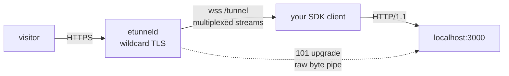

# etunnel SDKs - 20 languages, one wire protocol

[](../PROTOCOL.md)
[](../LICENSE)

Every SDK is a small client for the same server: it opens one outbound
WebSocket to `wss://<domain>/tunnel`, says `hello`, receives `welcome` with a
public HTTPS URL, and then relays HTTP requests received over that socket to a
local service.



There is no service account to create and nothing to install server-side: the
client dials out, so it works from laptops, CI runners and containers behind
NAT.

## Pick a language

| Language | Package | Install | Embed entry point | README |
|---|---|---|---|---|
| Go (reference) | `github.com/topcheer/etunnel/sdk` | `go get github.com/topcheer/etunnel/sdk` | `Connect(ctx, Options{})` | [sdk/](../sdk/README.md) |
| Node.js | `@easytunnel/et-sdk` | `npm i @easytunnel/et-sdk` | `connect(server, 3000)` | [node/](node/README.md) |
| TypeScript | `@easytunnel/et-sdk` / single file | `npm i @easytunnel/et-sdk` | `connect(server, 3000)` | [typescript/](typescript/README.md) |
| Deno | `@ggcode/etunnel` (JSR) | `deno add jsr:@ggcode/etunnel` | `connect(server, 3000)` | [deno/](deno/README.md) |
| Python | `etunnel` (PyPI) | `pip install etunnel` | `connect(server, 3000)` | [python/](python/README.md) |
| Java | `dev.ggcode:etunnel` | Maven Central | `Etunnel.connect(server, 3000, null)` | [java/](java/README.md) |
| Kotlin | `dev.ggcode:etunnel` | Maven Central | `Etunnel.connect(server, 3000)` | [kotlin/](kotlin/README.md) |
| Scala | `dev.ggcode:etunnel` | Maven Central | `Etunnel.connect(server, 3000)` | [scala/](scala/README.md) |
| C# | `etunnel` / single file | `dotnet add package etunnel` | `Etunnel.Connect(server, "3000")` | [csharp/](csharp/README.md) |
| Rust | `etunnel` (crates.io) | `cargo install etunnel` | binary - spawn as child | [rust/](rust/README.md) |
| Swift | single file (Foundation) | SPM / copy | `try await Etunnel(...).connect()` | [swift/](swift/README.md) |
| Dart | `etunnel` (pub.dev) | `dart pub add etunnel` | `Etunnel.connect(server, '3000')` | [dart/](dart/README.md) |
| Ruby | `etunnel` (RubyGems) | `gem install etunnel` | `Etunnel.connect(server, 3000)` | [ruby/](ruby/README.md) |
| PHP | `ggcode/etunnel` | `composer require ggcode/etunnel` | `Etunnel::connect(server, 3000)` | [php/](php/README.md) |
| Perl | single file (core modules) | `cpanm etunnel` | `etunnel_connect(server, local, {})` | [perl/](perl/README.md) |
| Lua | `ggcode.etunnel` (LuaRocks) | `luarocks install ggcode.etunnel` | script | [lua/](lua/README.md) |
| Clojure | `dev.ggcode/etunnel-clj` | deps.edn (Clojars) | `(connect! server 3000)` | [clojure/](clojure/README.md) |
| Elixir | `etunnel` (Hex) | `{:etunnel, "~> 1.2"}` | `Etunnel.start_link(...)` | [elixir/](elixir/README.md) |
| C | single file (`make`) | `make && make install` | binary - spawn as child | [c/](c/README.md) |
| C++ | single file (`cmake`) | `cmake -B build` | binary - spawn as child | [cpp/](cpp/README.md) |

Java coordinates:

```xml
<dependency>
  <groupId>dev.ggcode</groupId>
  <artifactId>etunnel</artifactId>
  <version>1.3.0</version>
</dependency>
```

## Capability matrix

| SDK | Streaming bodies | WebSocket (101) pass-through | Embeddable | Concurrency |
|---|---|---|---|---|
| Go | yes - chunked, flushes preserved | yes - raw byte pipe | library | full |
| Node, TypeScript, Deno | buffered per stream | no | library | full (event loop) |
| Python | buffered per stream | no | library | thread per tunnel |
| Java, Kotlin, Scala, Clojure | buffered per stream | no | library | JDK WebSocket callbacks |
| C#, Dart, Ruby, PHP, Perl, Swift | buffered per stream | no | library / single file | per client |
| Elixir | buffered per stream | no | OTP child | per client |
| Lua | buffered per stream | no | script | sequential (one request at a time) |
| Rust, C, C++ | buffered per stream | no | binary | per client |

"Buffered" means the request body is collected before it is forwarded and the
response body is collected before it is returned: correct for webhooks, JSON
APIs and dashboards, not for large uploads, SSE or WebSockets. Use the Go SDK
when you need those, or when a single tunnel must carry heavy concurrency.

## Run it in 60 seconds

```sh
npx @easytunnel/et-sdk 3000
#   TUNNEL_URL: https://quiet-frog-42.t.etun.uk
```

Every SDK file is also a CLI: `etunnel 3000`, `python -m etunnel 3000`,
`dotnet run Etunnel.cs 3000`, `swift etunnel.swift 3000`, ... They all honour:

| Variable | Meaning | Default |
|---|---|---|
| `ETUNNEL_SERVER` | tunnel server WebSocket URL | `wss://t.etun.uk/tunnel` |
| `ETUNNEL_LOCAL` | local port or `host:port` (first argument wins) | `3000` |
| `ETUNNEL_TOKEN` | paid-plan API key | - |
| `ETUNNEL_SUBDOMAIN` | requested subdomain (paid plans) | random |

## Protocol in one page

1. Client opens `wss://<domain>/tunnel` with subprotocol `etunnel-v1`.
2. Client sends `{"type":"hello","proto":1,"token"?,"subdomain"?,"client"?}`.
3. Server answers `{"type":"welcome","url":"https://...","hostname":"...","plan":"free","expiresIn":14400}`.
4. For each inbound request the server sends `{"type":"req","streamId":N,"method":"GET","path":"/x","headers":{...}}`,
   then binary frames `[kind|streamId|len|payload]`, then `fin`.
5. The client replays the request locally and streams `data` frames back, ending
   with `fin` (or `rst` to abort).
6. `ping`/`pong` keep the tunnel alive; `bye` closes it (server-initiated on TTL
   expiry, client-initiated on shutdown).

Full detail - every frame, header rule and error code - is in
[PROTOCOL.md](../PROTOCOL.md).

## Adding a language

1. Copy an existing buffer-based port (Python or Node is the clearest) into a
   new `sdks/<lang>/` directory.
2. Implement: WebSocket connect with subprotocol `etunnel-v1`, `hello`/`welcome`,
   `req` -> local HTTP request, data/fin frames, `ping`/`pong`, `bye`.
3. Make the file runnable (`<lang> etunnel.<ext> 3000`) and print
   `TUNNEL_URL: ...`.
4. Add an entry to `sdks/README.md` and to `scripts/gen_sdk_readmes.py`, then
   run `python3 scripts/gen_sdk_readmes.py` to regenerate that package's README.
5. Verify against a real server (or a local `etunneld -tls-mode http`) before
   publishing.

## License

MIT - see [LICENSE](../LICENSE).
