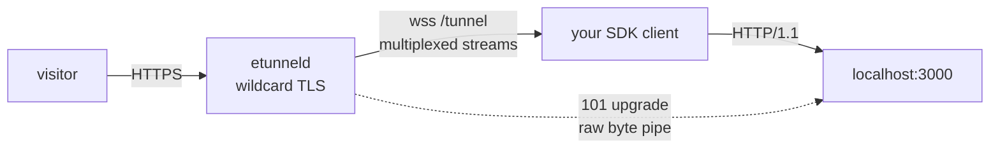

# etunnel SDKs - 22 SDKs, one wire protocol

[](../PROTOCOL.md)
[](../LICENSE)

Every SDK is a small client for the same server: it opens one outbound
WebSocket to `wss://<domain>/tunnel`, says `hello`, receives `welcome` with a
public HTTPS URL, and then relays HTTP requests received over that socket to a
local service.



There is no service account to create and nothing to install server-side: the
client dials out, so it works from laptops, CI runners and containers behind
NAT.

**Counting:** 22 SDKs in 20 languages - the Go reference SDK in [`sdk/`](../sdk/)
plus 21 directories under `sdks/` (19 language ports, the Android AAR and the
HarmonyOS ArkTS package). `sdks/testtools/` is a shared test fixture, not an
SDK. Seven of the 22 are not on a package registry yet (see the *Install*
column): TypeScript, Kotlin, Scala, Perl, HarmonyOS, C and C++ are used from
source.

## Pick a language

| Language | Package | Install | Embed entry point | README |
|---|---|---|---|---|
| Go (reference) | `github.com/topcheer/etunnel/sdk` | `go get github.com/topcheer/etunnel/sdk` | `etunnel.Connect(ctx, etunnel.Options{Server, LocalAddr})` | [sdk/](../sdk/README.md) |
| Node.js | `@easytunnel/et-sdk` | `npm install @easytunnel/et-sdk` | `connect(server, 3000)` | [node/](node/README.md) |
| TypeScript | single file `etunnel.ts` (the `etunnel-ts` npm name is not published) | copy `etunnel.ts`, or `npm install @easytunnel/et-sdk` for the JS build | `connect(server, 3000)` | [typescript/](typescript/README.md) |
| Deno | `@ggcode/etunnel` (JSR) | `deno add jsr:@ggcode/etunnel` | `connect(server, 3000)` | [deno/](deno/README.md) |
| Python | `etunnel` (PyPI) | `pip install etunnel` | `connect(server, 3000)` | [python/](python/README.md) |
| Java | `dev.ggcode:etunnel` (Maven Central) | Maven / Gradle coordinates below | `Etunnel.connect(server, 3000, null)` | [java/](java/README.md) |
| Kotlin (JVM) | `dev.ggcode:etunnel-kotlin` (Maven Central, package `dev.ggcode.etunnel`) | `implementation("dev.ggcode:etunnel-kotlin:1.7.37")`, or `kotlinc Etunnel.kt -include-runtime -d etunnel.jar`, or copy the file | `Etunnel.connect(server, 3000)` | [kotlin/](kotlin/README.md) |
| Scala | `dev.ggcode:etunnel_2.13` / `dev.ggcode:etunnel_3` (Maven Central, package `dev.ggcode.etunnel`) | `libraryDependencies += "dev.ggcode" %% "etunnel" % "1.7.37"`, or `scala Etunnel.scala -- 3000` | `Etunnel.connect(server, 3000)` | [scala/](scala/README.md) |
| C# | `etunnel` (NuGet) | `dotnet add package etunnel` | `await Etunnel.Connect(server, "3000")` | [csharp/](csharp/README.md) |
| Rust | `etunnel` (crates.io) | `cargo install etunnel` | binary - spawn as child (`etunnel 3000`); no library target yet | [rust/](rust/README.md) |
| Swift | `etunnel` (SwiftPM, **iOS 16+ / macOS 13+**) | `.package(url: "https://github.com/topcheer/etunnel.git", from: "1.7.35")` | `try await Etunnel(server: server, local: "3000")!.connect()` | [swift/](swift/README.md) |
| Dart | `etunnel` (pub.dev) | `dart pub add etunnel` | `await Etunnel.connect(server, '3000')` | [dart/](dart/README.md) |
| Ruby | `etunnel` (RubyGems) | `gem install etunnel` | `Etunnel.connect(server, 3000)` | [ruby/](ruby/README.md) |
| PHP | `ggcode/etunnel` (Packagist) | `composer require ggcode/etunnel` | `Etunnel::connect(server, 3000)` | [php/](php/README.md) |
| Perl | single file (core modules) | copy `etunnel.pl` (CPAN upload is paused) | `etunnel_connect(server, '127.0.0.1:3000', {})` | [perl/](perl/README.md) |
| Lua | `ggcode.etunnel` (LuaRocks) | `luarocks install ggcode.etunnel` | script: `lua etunnel.lua 3000` | [lua/](lua/README.md) |
| Clojure | `dev.ggcode/etunnel-clj` (Clojars) | `{:deps {dev.ggcode/etunnel-clj {:mvn/version "1.7.35"}}}` | `(connect! server 3000)` | [clojure/](clojure/README.md) |
| Elixir | `etunnel` (Hex) | `{:etunnel, "~> 1.7.35"}` | `Etunnel.start_link(server: server, local: 3000)` | [elixir/](elixir/README.md) |
| C | single file | `make etunnel` | binary - spawn as child | [c/](c/README.md) |
| C++ | single file | `cmake -B build && cmake --build build` | binary - spawn as child | [cpp/](cpp/README.md) |
| Android (AAR) | `dev.ggcode:etunnel-android` (Maven Central) | `implementation("dev.ggcode:etunnel-android:1.7.35")` | `Etunnel.connect(server, 3000)` | [android/](android/README.md) |
| HarmonyOS (ArkTS) | `etunnel` (ohpm, not published yet) | copy `Etunnel.ets` from source | `await connect(server, '3000')` | [harmonyos/](harmonyos/README.md) |

Known registry defects at version 1.7.35 (each is fixed at the source or in
the next release; until then use the "from source" form):

- npm `@easytunnel/et-sdk` 1.7.35 crashes at load with
  `Cannot find module './route'` - use `sdks/node/etunnel.js` + `route.js`
  from the repo.
- pub.dev `etunnel` 1.7.35 ships `etunnel.dart` at the package root instead of
  `lib/`, so `import 'package:etunnel/etunnel.dart'` fails - copy the file.
- LuaRocks `ggcode.etunnel` 1.7.35-1 fails to install (its rockspec points at
  git tag `v1.4.0`) - copy `etunnel.lua` (needs LuaSocket + LuaSec).
- PyPI `etunnel` 1.7.35 sends a browser `Origin` header and is refused by
  servers that enforce the SDK-only handshake (HTTP 403) - fix pending.
- Hex `etunnel` 1.7.35 (and the current source) fails on Elixir 1.20 / OTP 29
  (`KeyError :last_activity` in `start_link/1`); RubyGems `etunnel` 1.7.35
  fails on Ruby 4.0 (`SystemStackError`) - fixes pending.
- Clojars `dev.ggcode/etunnel-clj` does not declare `cheshire`; add
  `cheshire/cheshire` to your deps next to it.

Java / Kotlin / Android coordinates:

```xml
<dependency>
  <groupId>dev.ggcode</groupId>
  <artifactId>etunnel</artifactId>
  <version>1.7.35</version>
</dependency>
```

```kotlin
implementation("dev.ggcode:etunnel:1.7.35")              // Java SDK (JVM)
implementation("dev.ggcode:etunnel-android:1.7.35")      // Android AAR, minSdk 24
implementation("dev.ggcode:etunnel-kotlin:1.7.37")       // Kotlin SDK (package dev.ggcode.etunnel)
```

```scala
// Scala SDK: %% picks etunnel_2.13 / etunnel_3 from scalaVersion
libraryDependencies += "dev.ggcode" %% "etunnel" % "1.7.37"
```

> **Apple platforms**: the Swift SDK is an Apple-platform package (iOS 16+,
> macOS 13+; `URLSessionWebSocketTask` under the hood; visionOS and Mac
> Catalyst are not tested). Add it with
> `.package(url: "https://github.com/topcheer/etunnel.git", from: "1.7.35")`
> - the tag is the release, there is no registry. Linux is not supported by
> this SDK, see [swift/README.md](swift/README.md).

## Capability matrix

| SDK | Streaming bodies | WebSocket (101) pass-through | Embeddable | Concurrency |
|---|---|---|---|---|
| Go | yes - chunked, flushes preserved | yes - raw byte pipe | library | full |
| Node, TypeScript, Deno | buffered per stream | no | library | full (event loop) |
| Python | buffered per stream | no | library | thread per tunnel |
| Java, Kotlin, Scala, Clojure | buffered per stream | no | library | JDK WebSocket callbacks |
| Android (AAR) | buffered per stream | no | library | OkHttp WebSocket callbacks |
| HarmonyOS (ArkTS) | buffered per stream | no | library | ArkTS event loop |
| C#, Dart, Ruby, PHP, Perl, Swift | buffered per stream | no | library / single file | per client |
| Elixir | buffered per stream | no | OTP child | per client |
| Lua | buffered per stream | no | script | sequential (one request at a time) |
| Rust | buffered per stream | no | binary only: a `Tunnel` type with `done()` lives in `src/main.rs`, but the crate has no library target, so it cannot be imported from another crate yet | per client |
| C, C++ | buffered per stream | no | binary | per client |

"Buffered" means the request body is collected before it is forwarded and the
response body is collected before it is returned: correct for webhooks, JSON
APIs and dashboards, not for large uploads, SSE or WebSockets. Use the Go SDK
when you need those, or when a single tunnel must carry heavy concurrency.

## Run it in 60 seconds

```sh
npx @easytunnel/et-sdk 3000        # needs npm @easytunnel/et-sdk >= 1.7.36
#   TUNNEL_URL: https://quiet-frog-k3f9qz.t.etun.uk
```

Every SDK file is also a CLI. Verified invocations:

| SDK | CLI |
|---|---|
| Go | `etunnel 3000` (or `go run github.com/topcheer/etunnel/cmd/etunnel 3000`) |
| Node | `npx @easytunnel/et-sdk 3000` |
| TypeScript | `node etunnel.ts 3000` |
| Deno | `deno run --allow-net --allow-env etunnel.ts 3000` |
| Python | `python -m etunnel 3000` |
| Java | `java sdks/java/src/main/java/dev/ggcode/Etunnel.java 3000` |
| Kotlin | `java -jar etunnel.jar 3000` |
| Scala | `scala Etunnel.scala -- 3000` |
| C# | `dotnet run Etunnel.cs 3000` |
| Rust | `etunnel 3000` (after `cargo install etunnel`) |
| Swift | `swift run etunnel-cli 3000` |
| Dart | `dart run etunnel.dart 3000` |
| Ruby | `etunnel 3000` (gem) |
| PHP | `php etunnel.php 3000` |
| Perl | `perl etunnel.pl 3000` |
| Lua | `lua etunnel.lua 3000` |
| Clojure | `clojure -M -m etunnel 3000` |
| Elixir | `mix run runner.exs 3000` |
| C / C++ | `etunnel 3000` / `./build/etunnel 3000` |

They all honour:

| Variable | Meaning | Default |
|---|---|---|
| `ETUNNEL_SERVER` | tunnel server WebSocket URL | `wss://t.etun.uk/tunnel` |
| `ETUNNEL_LOCAL` | local port or `host:port` (first argument wins) | `3000` |
| `ETUNNEL_TOKEN` | API key (a free key unlocks one static subdomain) | - |
| `ETUNNEL_SUBDOMAIN` | requested subdomain (must be claimed on `/me` first) | random |
| `ETUNNEL_RECONNECT` | `0` disables auto-reconnect (one-shot run) | reconnect on |

The SDK CLIs print `TUNNEL_URL: <url>` when the tunnel is up and, with
auto-reconnect on, print it again after a successful reconnect (the subdomain
is reclaimed through the server's `resumeToken`). The one exception is the Go
CLI, which prints the URL on its own indented line
(`  https://<sub>.<domain>  ->  http://127.0.0.1:3000`, then
`plan: Free, expires: <time>`).

## AI agent quick-start (copy this prompt)

```text
Integrate etunnel into this project to expose the local service on port <PORT> at a public HTTPS URL.

- Step 1 - pick the SDK for this project's language from the "Pick a language" table in sdks/README.md (https://github.com/topcheer/etunnel/blob/main/sdks/README.md), open that SDK's README.md and use its Install and Embed sections verbatim. Do not guess package names or API signatures.
- Server: wss://t.etun.uk/tunnel (override with ETUNNEL_SERVER or the first connect() argument). Anonymous tier = random subdomain, 4h TTL, 1 Mbps; a custom subdomain or longer TTL needs an API key (the token option / ETUNNEL_TOKEN).
- Step 2 - install with the exact command from the table row. If the row says "single file" or "copy", copy that file from the repo instead of inventing a package name.
- Step 3 - use the minimal embed snippet from that SDK's README. Print the public URL as `TUNNEL_URL: <url>`, keep the process alive, and call the SDK's close method on shutdown to release the subdomain.
- Rules: every SDK except Go is buffer-based (request and response bodies are collected before forwarding: no WebSocket upgrades, no SSE/streaming, no large uploads) - fine for webhooks/APIs/dashboards. Use the Go SDK (github.com/topcheer/etunnel/sdk) when the app needs streaming bodies or WebSocket pass-through.
- Do not invent other options. Full API/options: the SDK's own README.md. Wire protocol: https://github.com/topcheer/etunnel/blob/main/PROTOCOL.md
```

## Protocol in one page

1. Client opens `wss://<domain>/tunnel` with subprotocol `etunnel-v1` (no
   `Origin` header - browsers are refused).
2. Client sends `{"type":"hello","proto":1,"token"?,"subdomain"?,"client"?,"version"?,"resume"?,"policy"?}`.
   Every SDK reports its own semver in `version` (e.g. `"1.7.39"`). If the server considers it
   too old it answers `{"type":"error","code":"client_outdated","message":"... Upgrade: https://github.com/topcheer/etunnel"}`
   instead of a welcome; SDKs surface that message verbatim (CLI: stderr + non-zero exit, library: the connect error / on_close).
3. Server answers `{"type":"welcome","proto":1,"url":"https://...","hostname":"...","subdomain":"...","plan":"Free","expiresAt":<unix seconds>,"resumeToken":"..."}`.
4. For each inbound request the server sends `{"type":"req","streamId":N,"method":"GET","path":"/x","headers":{...}}`,
   then binary frames `[kind|streamId|len|payload]` (9-byte big-endian header), then `FIN`.
5. The client replays the request locally, answers `{"type":"res","streamId":N,"status":200,"headers":{...}}`,
   then `DATA` frames ending with `FIN` (or `RST` to abort).
6. `ping`/`pong` keep the tunnel alive; `bye` closes it (server-initiated on TTL
   expiry, client-initiated on shutdown).

Full detail - every frame, header rule and error code - is in
[PROTOCOL.md](../PROTOCOL.md).

## Adding a language

1. Copy an existing buffer-based port (Python or Node is the clearest) into a
   new `sdks/<lang>/` directory.
2. Implement: WebSocket connect with subprotocol `etunnel-v1`, `hello`/`welcome`,
   `req` -> local HTTP request, DATA/FIN/RST frames, `ping`/`pong`, `bye`.
3. Make the file runnable (`<lang> etunnel.<ext> 3000`) and print
   `TUNNEL_URL: ...`.
4. Hand-write the README - the generators are retired, a template would drop
   sections. Mirror a sibling SDK's section order: `## Install`, `## CLI`,
   `## Embed`, `## API`, `## Options`, environment variables, reconnect, then
   `## AI agent quick-start (copy this prompt)` - and add a row to the table
   above. `make verify` fails when `## Install`, `## CLI`, `## Embed` or
   `## AI agent quick-start` is missing from any SDK README.
5. Verify against a real server (or a local `etunneld -tls-mode http`) before
   publishing.

## License

MIT - see [LICENSE](../LICENSE).
