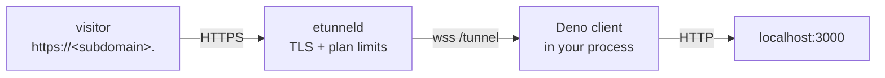

# etunnel for Deno

[](https://jsr.io/@ggcode/etunnel)
[](https://jsr.io/@ggcode/etunnel)

Zero-dependency Deno client, published on JSR: permissions are limited to `--allow-net`.

Every SDK speaks the same wire protocol against any etunnel server - the default is `wss://t.etun.uk/tunnel`, and `ETUNNEL_SERVER` or the first argument of `connect()` points at your own deployment.



## Install

```sh
deno add jsr:@ggcode/etunnel
# or import straight from the registry:
#   import { connect } from 'jsr:@ggcode/etunnel';
```

## Embed in your app

```ts
import { connect } from 'jsr:@ggcode/etunnel';

const tunnel = await connect('wss://t.etun.uk/tunnel', 3000);
console.log('public URL:', tunnel.url);

Deno.addSignalListener('SIGINT', () => {
  tunnel.close();
  Deno.exit(0);
});
```

## CLI

```sh
deno run --allow-net https://raw.githubusercontent.com/topcheer/etunnel/main/sdks/deno/etunnel.ts 3000
```

Prints `TUNNEL_URL: https://<subdomain>.<domain>`; `Ctrl-C` closes the tunnel and the server frees the subdomain immediately.

## API

| Symbol | Returns / effect |
|---|---|
| `connect(server, local, opts?)` | `Promise<Tunnel>` |
| `Tunnel.url` / `.hostname` / `.subdomain` / `.plan` | facts from the `welcome` frame |
| `Tunnel.close(reason?)` | graceful shutdown |

Options: `Options { token?, subdomain?, client?, onClose? }`

The tunnel keeps the URL for the lifetime of the process (or the plan TTL, whichever comes first); the server closes it with `bye` when the TTL expires, and `close()` releases it early.

Each account may hold as many concurrent tunnels as its plan allows (free 2, starter 5, pro 20); anonymous tunnels are additionally capped per source IP. Starting one too many is rejected with `limit_reached`.

## Environment variables

| Variable | Meaning | Default |
|---|---|---|
| `ETUNNEL_SERVER` | Tunnel server WebSocket URL | `wss://t.etun.uk/tunnel` |
| `ETUNNEL_LOCAL` | Local port or `host:port` (the first CLI argument wins) | `3000` |
| `ETUNNEL_TOKEN` | Paid-plan API key (enables custom subdomain + longer TTL) | - |
| `ETUNNEL_SUBDOMAIN` | Requested subdomain, paid plans only | random |

## Notes and limits

- Buffer-based client (no WS upgrades); the [Go SDK](../../sdk) handles those.
- Only needs `--allow-net`; no `--allow-read` or `--allow-run`.

## Troubleshooting

| Symptom | Cause | Fix |
|---|---|---|
| `ws: cannot connect to ...` | DNS, corporate proxy or firewall blocks the outbound socket | `curl -sI https://t.etun.uk/` from the same host; set `HTTPS_PROXY` if you need one |
| Public URL answers `404 - no tunnel here` | The tunnel process exited, or the plan TTL expired | Restart the client; the subdomain is released on disconnect |
| `error: invalid_token` | `token` set but not a paid-plan API key | Copy the key from `/me` on the portal, or drop the token for an anonymous tunnel |
| `error: too_many_tunnels` | Per-IP anonymous tunnel cap on the server | Close old clients (`lsof -ti:PORT`), or use a paid plan with a token |
| `error: subdomain_taken` | Custom subdomain already claimed by another account | Pick another name, or remove it from the old account in `/me` |
| Request hangs, then `502` | Local service is not listening on the requested port | `curl -sv http://127.0.0.1:3000/` first |
| WebSocket endpoints fail through the tunnel | Buffer-based SDK (all but Go) cannot forward 101 upgrades | Use the [Go SDK](../../sdk) for WebSocket pass-through |

## See also

- [All 20 SDKs](../README.md) - install matrix and capability comparison
- [Wire protocol](../../PROTOCOL.md) - frames, control messages, stream lifecycle
- [Repository](https://github.com/topcheer/etunnel) - server, Go SDK, examples, self-hosting
- [LICENSE](../../LICENSE) - MIT
