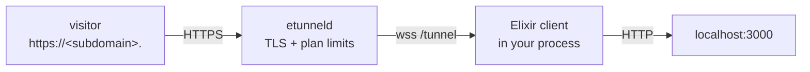

# etunnel for Elixir

[](https://hex.pm/packages/etunnel)
[](https://hex.pm/packages/etunnel)

OTP-friendly client: a supervised process holds the tunnel and `Etunnel.url/1` reports the public URL.

Every SDK speaks the same wire protocol against any etunnel server - the default is `wss://t.etun.uk/tunnel`, and `ETUNNEL_SERVER` or the first argument of `connect()` points at your own deployment.



## Install

```sh
# mix.exs
defp deps do
  [{:etunnel, "~> 1.2.0"}]
end
```

## Embed in your app

```elixir
# supervised (recommended)
children = [{{Etunnel, server: "wss://t.etun.uk/tunnel", local: 3000}}]
{{:ok, _}} = Supervisor.start_link(children, strategy: :one_for_one)

# or standalone
{{:ok, tunnel}} = Etunnel.start_link(server: "wss://t.etun.uk/tunnel", local: 3000)
IO.puts("public URL: " <> Etunnel.url(tunnel))
Process.sleep(:infinity)
```

## CLI

```sh
mix run --no-halt runner.exs 3000
```

Prints `TUNNEL_URL: https://<subdomain>.<domain>`; `Ctrl-C` closes the tunnel and the server frees the subdomain immediately.

## API

| Symbol | Returns / effect |
|---|---|
| `Etunnel.start_link(server:, local:, token:, subdomain:)` | `{:ok, pid}` |
| `Etunnel.url(pid)` | `String` - public HTTPS URL |
| `:local` | port number or `"host:port"` |

Options: `Etunnel.start_link(server: server, local: 3000, subdomain: "myapp", token: "et_...")`

The tunnel keeps the URL for the lifetime of the process (or the plan TTL, whichever comes first); the server closes it with `bye` when the TTL expires, and `close()` releases it early.

## Environment variables

| Variable | Meaning | Default |
|---|---|---|
| `ETUNNEL_SERVER` | Tunnel server WebSocket URL | `wss://t.etun.uk/tunnel` |
| `ETUNNEL_LOCAL` | Local port or `host:port` (the first CLI argument wins) | `3000` |
| `ETUNNEL_TOKEN` | Paid-plan API key (enables custom subdomain + longer TTL) | - |
| `ETUNNEL_SUBDOMAIN` | Requested subdomain, paid plans only | random |

## Notes and limits

- Buffer-based client (no WS upgrades); the [Go SDK](../../sdk) handles those.
- Uses `:gun` for the WebSocket connection, so the tunnel is an ordinary OTP child that restarts on crash.

## Troubleshooting

| Symptom | Cause | Fix |
|---|---|---|
| `ws: cannot connect to ...` | DNS, corporate proxy or firewall blocks the outbound socket | `curl -sI https://t.etun.uk/` from the same host; set `HTTPS_PROXY` if you need one |
| Public URL answers `404 - no tunnel here` | The tunnel process exited, or the plan TTL expired | Restart the client; the subdomain is released on disconnect |
| `error: invalid_token` | `token` set but not a paid-plan API key | Copy the key from `/me` on the portal, or drop the token for an anonymous tunnel |
| `error: too_many_tunnels` | Per-IP anonymous tunnel cap on the server | Close old clients (`lsof -ti:PORT`), or use a paid plan with a token |
| `error: subdomain_taken` | Custom subdomain already claimed by another account | Pick another name, or remove it from the old account in `/me` |
| Request hangs, then `502` | Local service is not listening on the requested port | `curl -sv http://127.0.0.1:3000/` first |
| WebSocket endpoints fail through the tunnel | Buffer-based SDK (all but Go) cannot forward 101 upgrades | Use the [Go SDK](../../sdk) for WebSocket pass-through |

## See also

- [All 20 SDKs](../README.md) - install matrix and capability comparison
- [Wire protocol](../../PROTOCOL.md) - frames, control messages, stream lifecycle
- [Repository](https://github.com/topcheer/etunnel) - server, Go SDK, examples, self-hosting
- [LICENSE](../../LICENSE) - MIT
