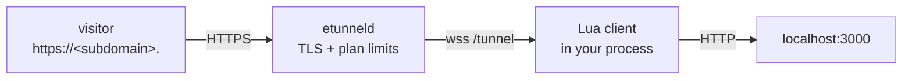

# etunnel for Lua

[](https://luarocks.org/modules/topcheer/ggcode.etunnel)
[](https://luarocks.org/modules/topcheer/ggcode.etunnel)

LuaRocks rock for Lua 5.3+ using lua-http (has client SNI, required for `wss` against an ACME server).

Every SDK speaks the same wire protocol against any etunnel server - the default is `wss://t.etun.uk/tunnel`, and `ETUNNEL_SERVER` or the first argument of `connect()` points at your own deployment.



## Install

```sh
luarocks install ggcode.etunnel
# pulls lua-http + cqueues
```

## Embed in your app

```lua
-- etunnel.lua is a script: run it, or wrap its connect() in your own runner
local etunnel = dofile('etunnel.lua')   -- executes the CLI when run directly

-- for an in-process tunnel, copy the file and remove the CLI tail at the end,
-- then: local tunnel = connect(server, 3000)
```

## CLI

```sh
lua etunnel.lua 3000
lua $(luarocks show ggcode.etunnel | awk '/Location/{print $2}')/etunnel.lua 3000
```

Prints `TUNNEL_URL: https://<subdomain>.<domain>`; `Ctrl-C` closes the tunnel and the server frees the subdomain immediately.

## API

| Symbol | Returns / effect |
|---|---|
| `connect(server, local_port, token, subdomain)` | table `{url, run()}` (module-local function) |
| `tunnel.run()` | blocking serve loop |

Options: `connect('wss://t.etun.uk/tunnel', 3000, 'et_...', 'myapp')`

The tunnel keeps the URL for the lifetime of the process (or the plan TTL, whichever comes first); the server closes it with `bye` when the TTL expires, and `close()` releases it early.

Each account may hold as many concurrent tunnels as its plan allows (free 2, starter 5, pro 20); anonymous tunnels are additionally capped per source IP. Starting one too many is rejected with `limit_reached`.

## Environment variables

| Variable | Meaning | Default |
|---|---|---|
| `ETUNNEL_SERVER` | Tunnel server WebSocket URL | `wss://t.etun.uk/tunnel` |
| `ETUNNEL_LOCAL` | Local port or `host:port` (the first CLI argument wins) | `3000` |
| `ETUNNEL_TOKEN` | Paid-plan API key (enables custom subdomain + longer TTL) | - |
| `ETUNNEL_SUBDOMAIN` | Requested subdomain, paid plans only | random |

## Notes and limits

- Buffer-based client (no WS upgrades); the [Go SDK](../../sdk) handles those.
- Requests are served sequentially (one at a time) - fine for webhooks and dev, not for concurrency-heavy APIs.
- LuaSec has no client-side SNI, which is why this uses lua-http instead.

## Troubleshooting

| Symptom | Cause | Fix |
|---|---|---|
| `ws: cannot connect to ...` | DNS, corporate proxy or firewall blocks the outbound socket | `curl -sI https://t.etun.uk/` from the same host; set `HTTPS_PROXY` if you need one |
| Public URL answers `404 - no tunnel here` | The tunnel process exited, or the plan TTL expired | Restart the client; the subdomain is released on disconnect |
| `error: invalid_token` | `token` set but not a paid-plan API key | Copy the key from `/me` on the portal, or drop the token for an anonymous tunnel |
| `error: too_many_tunnels` | Per-IP anonymous tunnel cap on the server | Close old clients (`lsof -ti:PORT`), or use a paid plan with a token |
| `error: subdomain_taken` | Custom subdomain already claimed by another account | Pick another name, or remove it from the old account in `/me` |
| Request hangs, then `502` | Local service is not listening on the requested port | `curl -sv http://127.0.0.1:3000/` first |
| WebSocket endpoints fail through the tunnel | Buffer-based SDK (all but Go) cannot forward 101 upgrades | Use the [Go SDK](../../sdk) for WebSocket pass-through |

## See also

- [All 20 SDKs](../README.md) - install matrix and capability comparison
- [Wire protocol](../../PROTOCOL.md) - frames, control messages, stream lifecycle
- [Repository](https://github.com/topcheer/etunnel) - server, Go SDK, examples, self-hosting
- [LICENSE](../../LICENSE) - MIT
